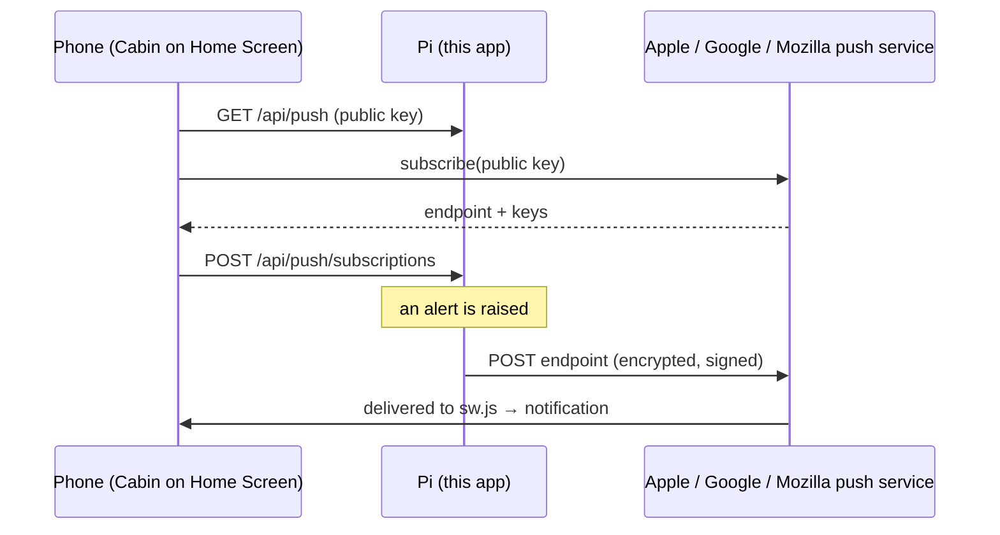

# Alerts on a phone: Web Push to Cabin

Cabin can send its alerts straight to a phone's lock screen, beside email or
instead of it. The phone is the Cabin app you have already added to its Home
Screen. There is nothing else to install, no third-party account, and no
service in the middle that can read the alerts.

**Verified:** the message encryption, the signature and the server side, by the
test suite, including the worked example in RFC 8291. **Not yet verified on a
real iPhone at the time of writing.** Treat the first test alert as the real
test.

## Setting it up

### What you need

- An iPhone or iPad on **iOS / iPadOS 16.4 or later**, or a desktop browser:
  Chrome, Edge, Firefox or Safari on a Mac. Android with Chrome works too.
- Cabin opened over **HTTPS with a certificate the device trusts**. Push will
  not start on a plain `http://` address. With a Let's Encrypt certificate
  (README → "HTTPS on Your Own Network", Option B) every device already trusts
  it. With the default internal CA, its root certificate must be installed
  and trusted on the phone first, as the same section describes.
- An administrator, once, to switch alerts on (step 3).

### 1. Put Cabin on the Home Screen (iPhone and iPad)

Apple delivers web notifications only to an app on the Home Screen, never to
a Safari tab.

1. Open Cabin in **Safari**.
2. Tap **Share**, then **Add to Home Screen**, then **Add**.
3. From now on, open Cabin **from that icon**.

Already done this? Skip it. On a computer or Android phone there is nothing to
add; the browser itself receives them.

### 2. Turn alerts on for this phone

On the phone, in Cabin from the Home Screen icon:

1. **Settings → Alerts → Phones and tablets → Turn on alerts on this device.**
2. Tap **Allow** when iOS asks.
3. Tap **Send a test.** A notification should appear within a few seconds,
   even with Cabin closed.

Every person does this on their own phone, signed in as themselves. Anyone
signed in may do it; they do not need to be an administrator.

### 3. Choose what is sent (an administrator, once)

Under **Settings → Alerts**:

1. Switch on **Send alerts**.
2. Tick the events you want, exactly as for email. Quiet hours apply to phones
   as well.
3. **Email is optional.** Leave the email fields empty to send to phones only.
   Alerts cannot be switched on with neither email nor a phone, because they
   would never reach anybody.
4. **Save alerts.**

### Away from the cabin

**An alert arrives wherever the phone is: on mobile data, abroad, without the
VPN.** Your Pi hands it to Apple (or Google or Mozilla), and they deliver it as
they do any other notification. The Pi only needs its own internet
connection.

The VPN is still needed for the two things that talk to the Pi itself:

- **turning alerts on** (step 2), and
- **opening Cabin by tapping an alert.** Off the cabin network without the VPN,
  the alert still shows in full but the tap cannot load Cabin.

**Signing in again does not affect alerts.** The subscription belongs to the
phone, not to the session, so alerts keep arriving after you have been signed
out.

### When something is wrong

| What you see | What to do |
| --- | --- |
| "On iPhone and iPad, alerts come only to Cabin on the Home Screen" | You are in a Safari tab. Do step 1 and open Cabin from the icon. |
| "Notifications are blocked for Cabin" | You tapped *Don't Allow* once and iOS remembers it. **iPhone Settings → Notifications → Cabin → Allow Notifications**, then try again. |
| "Alerts need Cabin to be opened over HTTPS…" | The address is `http://`, or the certificate is not trusted. |
| The test says "The push service refused it: …" | The words after the colon are Apple's (or Google's) own reason. `403 BadJwtToken` usually means the Pi's clock is badly wrong. |
| The test says the device "no longer accepts notifications" | The app was removed from the Home Screen, or its notifications were reset. Turn alerts on again from the phone. |
| A device in the list says "Not reached" | Its last delivery failed. Use **Test** to see the current reason. |
| Nothing arrives, but no error | Check Focus or Do Not Disturb, and **Settings → Notifications → Cabin** on the phone. Also check that **Send alerts** is on and that the event is ticked. |

After **restoring from a backup**, each phone must turn alerts on again (step
2). The key that signs alerts is deliberately left out of backups, so a restore
makes a new one. Pressing the button on the phone replaces the old
subscription automatically.

## How it works

It is the standard Web Push protocol, written here in `app/webpush.py` on top
of `cryptography`. No third-party push library is involved.

- **RFC 8291, message encryption.** Each alert is encrypted to the phone's own
  key with a fresh key and salt (`aes128gcm`). Apple and the others carry the
  message but cannot read it.
- **RFC 8292, VAPID.** Every request is signed with this installation's P-256
  key. A push service accepts messages for a subscription only from the key
  the subscription was made with. The token lasts 12 hours, and its subject is
  the project's repository URL.
- **RFC 8030 headers.** `TTL` is 24 hours. A phone that is off for longer
  misses the alert rather than receiving it late. `Urgency` follows severity
  (info → low, warning → normal, critical → high). `Topic` is derived from
  the alert's condition key, so a recovery replaces its fault on the push
  service if neither has been delivered yet.

### What is sent, and to where

- **Only to a browser push service.** A subscription is accepted, and a push
  sent, only to `https` on port 443 at `web.push.apple.com`,
  `*.push.apple.com`, `fcm.googleapis.com`,
  `updates.push.services.mozilla.com` or `*.notify.windows.com`. There are no
  credentials in the URL and no redirects. Otherwise a subscription would be a
  way to make the Pi POST to any address on its network.
- The payload is the title, a few lines of facts and the prose of the email,
  without the footer. It is capped at 3 000 bytes.
- `sw.js` shows every message it receives. iOS withdraws push from a site that
  receives a message and shows nothing. Tapping a notification opens Cabin's
  front page. Alerts do not deep-link to a room.
- The service worker has **no fetch handler**. It does not cache Cabin or sit
  between the app and the Pi. It exists only to show alerts.

### Storage

`data/webpush/`, folder `0700`, files `0600`:

| File | Contents |
| --- | --- |
| `vapid_private.pem` | This installation's signing key, made the first time anybody opens the Alerts page. A damaged key is reported, never silently replaced, because replacing it would silently cut off every phone. |
| `subscriptions.json` | Each phone's push address, its two public keys, the user who turned it on, and when it was last reached. At most 50 devices. |

**Both are left out of backups** (`scripts/backup.sh`). Everything else under
`data/` is backed up. The key signs alerts and a subscription's address is
enough to send to that phone, so neither should sit in a backup folder. The
cost is one tap per phone after a restore.

The interface never receives a push address or key. Each device is shown with
a hash of its address, which is how a phone recognises itself in the list.

### Who may do what

| | Any signed-in user | Administrator |
| --- | --- | --- |
| Turn alerts on for their own phone | ✓ | ✓ |
| See, test and remove their own devices | ✓ | ✓ |
| See, test and remove everybody's devices | | ✓ |
| Choose whether anything is sent, and what | | ✓ |

Another user's device answers `404`, not `403`, so its id is not confirmed. A
user who is **removed** stops receiving alerts at once. A **renamed** user
keeps their devices. A phone that signs in as somebody else moves to that
person.

### API

| Endpoint | Purpose |
| --- | --- |
| `GET /api/push` | The public key, and the devices this user may see |
| `POST /api/push/subscriptions` | Body: the browser's `PushSubscription.toJSON()`. Checks the address and keys; `400` if either is wrong |
| `DELETE /api/push/subscriptions/{id}` | Remove a device |
| `POST /api/push/subscriptions/{id}/test` | Send one test alert. `410` if the phone has gone (it is then removed), `502` with the push service's own words if it was refused |
| `GET /sw.js` | The service worker. Served from the root because a worker controls only pages at or below its own path. It is behind sign-in, like every other script. |

### Limits worth knowing

- **iOS has no "critical" level for the web.** Critical alerts arrive with
  high urgency and stay on screen until dismissed, but Focus can still hold
  them back. If an alert must break through Do Not Disturb, keep email on as
  well, or allow Cabin under the Focus.
- Delivery is best effort at Apple's end. A **Send a test** that arrives is the
  only proof that a phone is set up.
- A push service that is down, slow or refusing can never affect the heating.
  Each device is tried on the notifier's worker thread with a 10-second
  timeout. Failures are recorded against the device and logged, and email is
  still sent.
